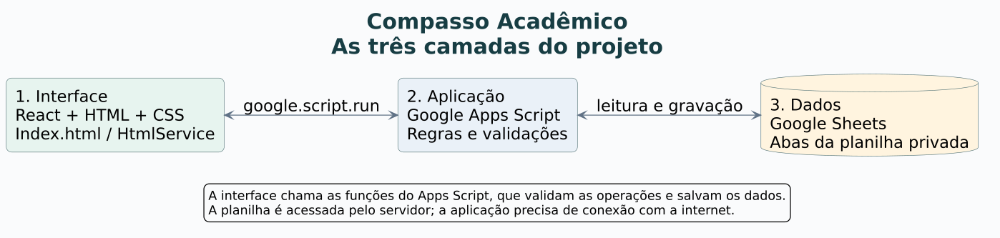

# Arquitetura

O Compasso tem três camadas: apresentação, aplicação e dados.

## Apresentação

`frontend/` contém a interface React, os formulários e a comunicação com o servidor. A compilação reúne o código e o CSS em `apps-script/Index.html`, servido pelo `HtmlService` do Google.

A comunicação usa chamadas assíncronas de funções por `google.script.run`, com tratamento de sucesso e erro. A interface confirma uma alteração depois da resposta do servidor. A abertura do aplicativo e as gravações dependem de conexão; os dados já carregados permanecem disponíveis para consulta na tela.

## Aplicação

`backend/` contém as funções do Apps Script, a sessão da demonstração e as regras financeiras. O código TypeScript é compilado para `apps-script/Code.gs` e executado no ambiente V8 do Google.

A classe `FinanceService` valida valores, referências e versões. Seu método `apply` recebe o estado e um comando e devolve o estado atualizado e o resultado. Os tipos e cálculos usados pelo servidor e pela interface ficam em `shared/domain/`.

## Dados

`SheetsFinanceRepository` concentra a leitura e a gravação nas abas da planilha Google Sheets. A função de configuração cria a planilha e guarda seu identificador nas propriedades do script. Esse identificador não precisa ser enviado ao navegador nem publicado no repositório.

O acesso é realizado pelo Apps Script com as permissões da conta que publica o aplicativo. A planilha permanece privada; os visitantes recebem somente os dados de sua própria sessão pelo servidor.

## Fluxo de uma alteração

1. A interface cria um comando com identificador próprio.
2. `google.script.run` envia o token da sessão e o comando ao servidor.
3. O servidor valida a sessão e usa `ScriptLock` para proteger a operação de acessos simultâneos.
4. O serviço aplica as regras ao estado atual.
5. O repositório grava uma nova versão dos dados e confirma o ponteiro da sessão.
6. O servidor devolve o estado confirmado, a revisão e o resultado.

O identificador evita executar novamente um reenvio já confirmado. A revisão da sessão e as versões dos registros protegem alterações concorrentes. O detalhamento das gravações versionadas está em [Organização dos dados](modelo-dados.md).

## Funções de comunicação

| Função | Finalidade |
| --- | --- |
| `compassoBootstrap(token)` | Consultar os dados da sessão. |
| `compassoCreateDemoSession(previousToken?)` | Iniciar ou reiniciar a demonstração. |
| `compassoCommand(token, commandJson)` | Validar e executar uma ação financeira. |
| `configurarCompasso_()` | Criar/configurar a planilha pelo editor do Apps Script. |

A função de configuração é usada no editor, não pela interface pública.

## Sessões

Cada visitante usa um token próprio, validado pelo servidor. O armazenamento contém o hash do token e um prazo de sete dias para a sessão.

Quando o navegador permite armazenamento local, o token pode ser reutilizado nos próximos acessos. Caso esse armazenamento esteja bloqueado, a aplicação o mantém em memória; ao recarregar, pode ser necessário iniciar outra sessão. Não existe compartilhamento de dados financeiros entre visitantes.
